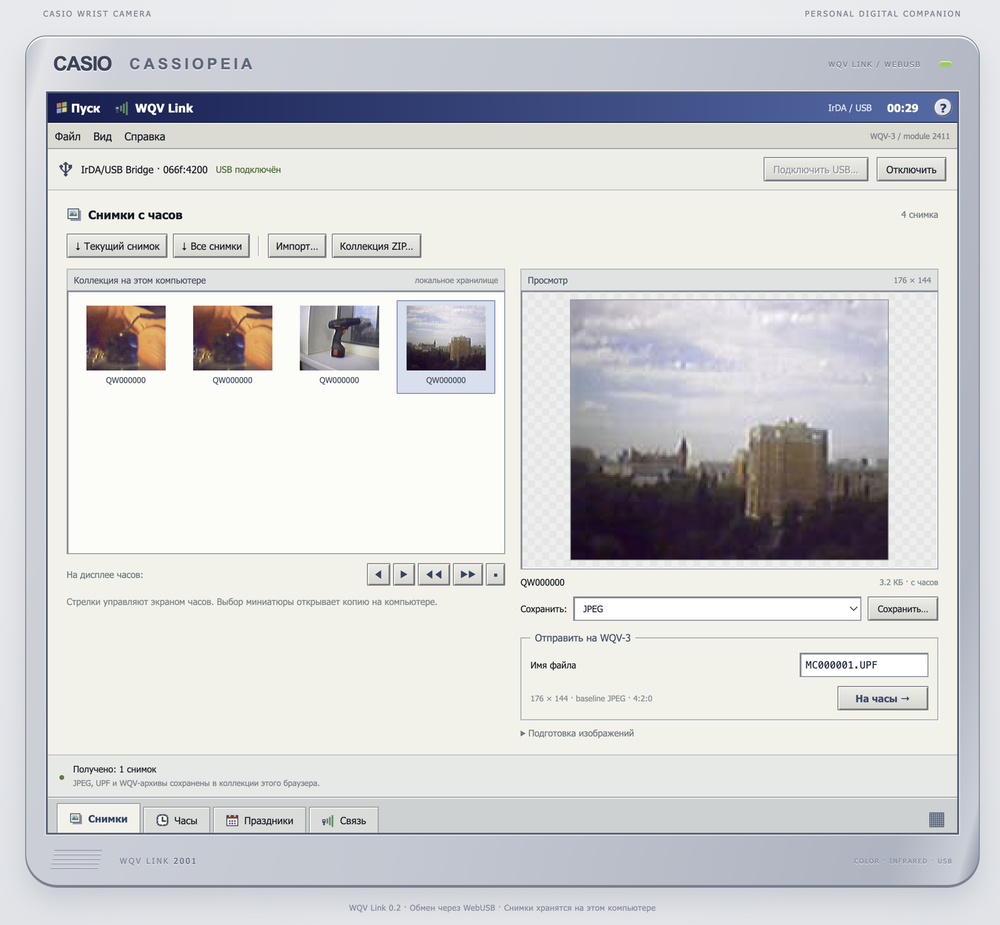

# WQV-online

Get photos on and off a Casio WQV-3 wrist camera in your browser. A USB infrared
adapter connects directly to the page through WebUSB. The interface takes its
look from the Casio CASSIOPEIA handhelds and Pocket PC 2000.

**[Open the app](https://bolknote.github.io/WQV-online/)**



## What you need

The tested setup is a **Casio WQV-3, module 2411**, a **SigmaTel STIr4200 USB
infrared adapter (`066f:4200`)**, and Opera on macOS. The adapter may identify
itself as “IrDA/USB Bridge.” No Windows virtual machine or kernel driver is
needed for this setup.

USB access needs a desktop browser with WebUSB, such as Chrome, Edge or Opera.
Safari and Firefox cannot connect to the adapter. The app starts in English.
Choose **Tools → Options…** to switch to Russian. It remembers your choice in
this browser, and switching languages keeps your current photo and connection.

Other infrared adapters need their own USB transport code. **ARK3116T does not
work yet.** WQV-10 and other operating systems have not been tested.

## Connect the watch

1. Plug in the SigmaTel adapter and open [the app](https://bolknote.github.io/WQV-online/).
2. Click **Connect USB…** and choose the adapter.
3. On the watch, select **IR → PC**, then **F / REMOTE**. Face its infrared
   window toward the adapter, about 5–10 cm apart.
4. Download the current photo or the whole collection. You can also import
   an image from your computer and send it to the watch.

If the watch leaves transfer mode, enter IR → PC again. Another application
using the adapter must release it before the browser can connect.

## Photos and settings

- Download individual photos or the whole collection. The arrow buttons browse
  photos on the watch; clicking a thumbnail opens the local copy.
- Import images, crop or fit them, rotate them, and prepare a 176 × 144 JPEG
  for the watch.
- Save JPEGs, keep the original UPF or WQV files, or export the collection as a ZIP.
- Read and edit the holiday calendar for 2000–2039, with JSON backups.
- Set the date and time, or sync with the computer at the start of a minute.

Photo downloads, uploads and calendar reading have been checked on a real WQV-3.
Clock setting and calendar writing are implemented and have packet tests, but
have not yet been checked on the watch.

Some JPEGs returned by the watch lose their restart interval marker. The app
repairs these for viewing and export without recompressing the image, while
keeping the original file.

Photos and calendar backups stay in this browser. There is no account, upload
server or analytics. Keep a ZIP export if you want a copy outside browser
storage. The hosted app and a localhost copy have separate collections.

Deleting a local photo only removes that browser copy. Deleting a photo from
the watch still takes the watch's buttons; the app's Help menu has the steps.

## Run locally

The app is plain HTML, CSS and JavaScript. There are no packages to install and
no build step.

```sh
git clone https://github.com/bolknote/WQV-online.git
cd WQV-online
python3 serve.py
```

Open <http://127.0.0.1:8765/> in a browser with WebUSB. Python only serves the
files in `dist/`; all USB communication happens in the browser. Use HTTPS or
localhost, rather than opening `index.html` as a file.

Run the tests with Node.js 24 or later:

```sh
npm test
```

There is also an independent JPEG pixel check, using Python and Pillow:

```sh
python3 -m venv .venv
.venv/bin/python -m pip install Pillow
.venv/bin/python tests/verify-jpeg-pixels.py
```

GitHub Actions runs the JavaScript tests on pushes and pull requests. A passing
push to `main` publishes `dist/` to GitHub Pages, so the site's root opens the
app directly.

## Credits and license

By Evgeny Stepanischev. Released under the [MIT license](LICENSE).

The watch protocol work builds on Roger Braunstein's
[WQV Blink](https://github.com/partlyhuman/wqv-blink), also MIT licensed. Its
copyright and license are preserved in [third-party-notices.txt](third-party-notices.txt).
The Linux [STIr4200 driver](https://github.com/torvalds/linux/blob/v4.16/drivers/staging/irda/drivers/stir4200.c)
was a reference for the adapter's registers and USB framing. Additional watch
commands were worked out from Casio's original PC software.
