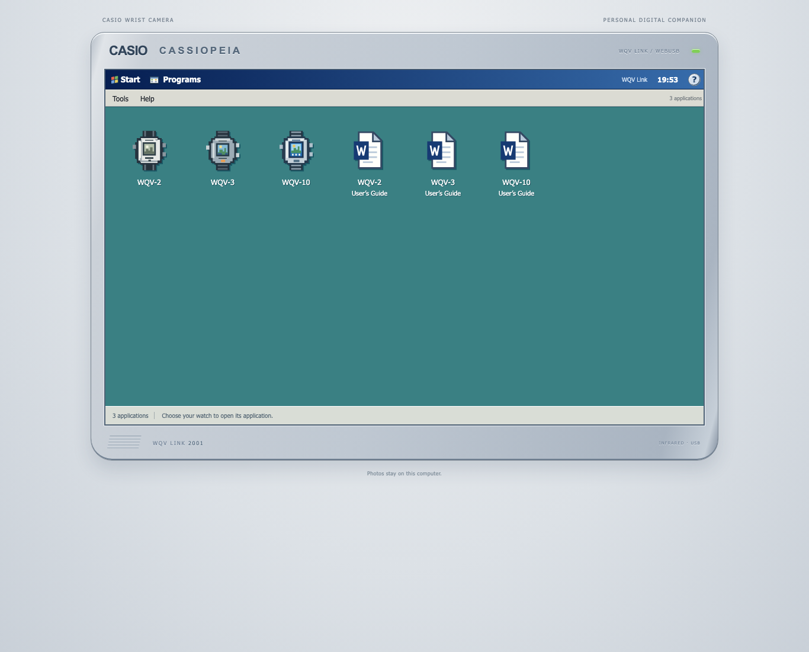
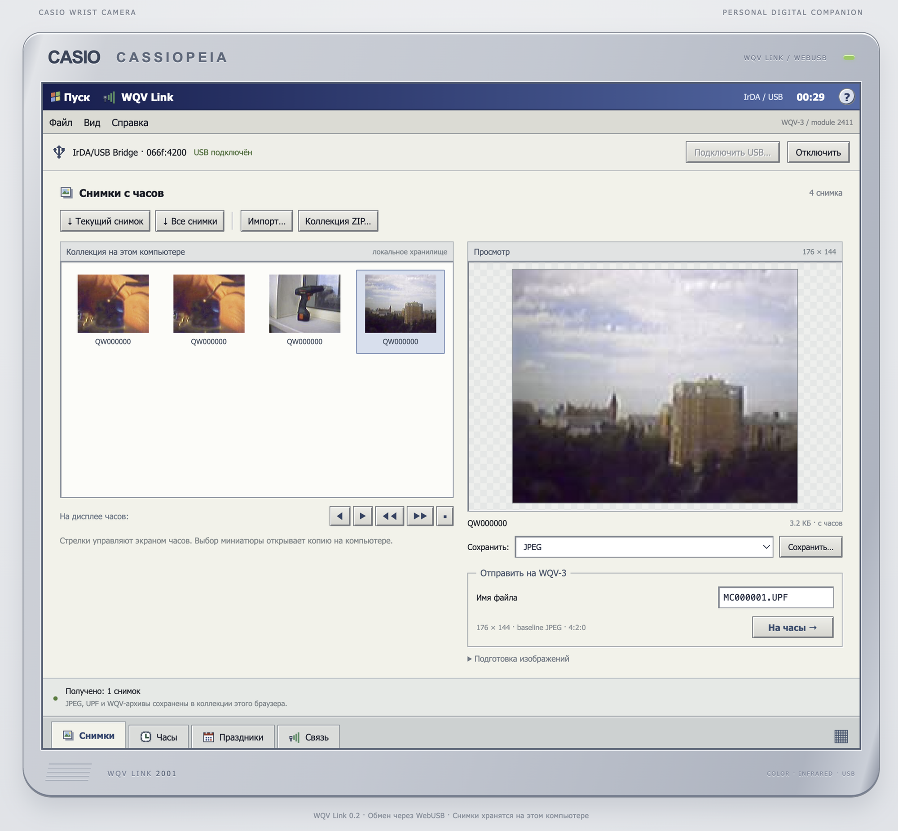

# WQV-online

Read photos from a Casio wrist camera in your browser. There are applications
for WQV-1/2, WQV-3 and WQV-10, with photo uploads for the two colour models.
Connect a USB infrared adapter through WebUSB or the
KS-959 local helper. The interface takes its look from the Casio CASSIOPEIA
handhelds and Pocket PC 2000.

**[Open the app](https://bolknote.github.io/WQV-online/)**

The opening screen has three watch apps, their guides and Settings. Click your watch’s icon to open its app; the
close button returns to Programs and releases the USB adapter. Each app has
its own local album. WQV-1 and WQV-2 share module 2220, so they use one app,
album and user guide. English, Russian, Japanese, German, Spanish and Finnish
settings apply to all three apps.

The three manual files beside the watch apps open in a Pocket Word-style reader.
They follow the selected display language. Spanish has WQV-1/2 and WQV-3;
Finnish has WQV-3. German has WQV-1/2 and WQV-10. Where a guide is unavailable,
the reader opens the English edition and keeps the “User’s Guide” label.
The guides use reflowable HTML with the original illustrations; the Japanese,
German and Spanish editions have text recognized from scanned PDFs. The reader
has a contents list and a text-size setting.
Original PDF links are available in its File menu. Sources and file hashes are
listed in [the manual catalog](dist/manuals/manifest.json).



## What you need

The tested watches are **Casio WQV-2, module 2220**, and **WQV-3, module 2411**,
on macOS. WQV-3 was tested with Opera; WQV-2 PC downloads were checked with the
native client on both adapters below.

| Adapter | USB ID | Connection |
| --- | --- | --- |
| SigmaTel STIr4200, often called “IrDA/USB Bridge” | `066f:4200` | Direct WebUSB |
| KingSun KS-959, called “USB to IRDA” | `07d0:4959` | Local Python helper |

Neither adapter needs a Windows virtual machine or a kernel driver. The page
uses the USB ID to choose its driver and displays the name supplied by the device.

USB access needs a desktop browser with WebUSB, such as Chrome, Edge or Opera.
Safari and Firefox cannot connect to the adapter. The app starts in English.
Choose **Start → Settings → Language** to switch to Russian, Japanese, German,
Spanish or Finnish. **Calendar display** lets you start the week on Monday or
Sunday. Both choices are remembered in this browser and apply across the apps.
Changing them keeps your current photo, connection and calendar month.
Settings opens in a small window. Use the titlebar’s cross to close it.

The USB helpers refuse to open a device if two connected adapters have the
same USB ID. Unplug the extra adapter before connecting. After updating a
helper, restart its Python process to use the new version.

Other infrared adapters can use a C driver installed through **Drivers**.
The available Linux API supports the ten reference sources listed below;
another source may need additional API services. **ARK3116T does not
work yet.** WQV-1, WQV-10 and other operating systems have not been tested.

### Installing a C driver

Open **Settings → Infrared drivers**. Use **Add…** to select a Linux
driver's C file and any extra headers, or choose **Reference sources…**. The
source is saved before compilation. WCC compiles it locally in a Worker, and
the resulting Wasm module stays in this browser. You can cancel a build,
add a missing header later, rebuild, save the source or remove the driver.

The reference sources are SigmaTel STIr4200, KingSun KS-959, KingSun/DonShine,
KingSun Dazzle, MosChip MCS7780, ARK3116, `irda-usb`, the corrected Linux 5.6
`ir-usb`, Prolific PL2303 and Mobile Action MA-620. The C files are unchanged
and keep their GPL notices. The compiler,
compatibility layer and source files ship with the site; no remote compiler
is involved.

The source selector includes USB VID:PID pairs extracted from compiled C
registration tables. A long list is shortened in the selector, with the full
list below it. Regenerate these labels after changing a reference source with
`node scripts/update-driver-usb-matches.mjs`; browser tests compare them with
the real compiled tables.

**MA-620 (`0df7:0620`)** combines the original PL2303 USB-serial driver with
`ma600-sir.c`, as described in Linux's MA600 Kconfig entry. Adding the MA-620
reference source also saves `pl2303.c` and `pl2303.h`. The C dongle driver
controls DTR/RTS, reset, command echo and SIR rates from 9600 to 115200 bit/s.
USB initialization and speed changes are separate from testing a photo
transfer. On a physical MA-620 connected to macOS, initialization, echoed
commands and all five SIR speeds passed through USB Helper; the captured
sequence is in `tests/fixtures/ma620-usb-hardware.json`. A photo transfer with
this adapter has not yet been tested. The PL2303-only source initializes a
serial port; it cannot configure
an infrared transceiver by itself. An installed MA-620 driver takes precedence
over a PL2303-only match. Other PL2303 serial devices are never sent MA600
commands. Devices requiring endpoints on separate USB interfaces are not
supported by this compatibility layer.

WQV Link reads the USB match table exported by each compiled C driver and
chooses an installed match when connecting. An exact USB ID takes precedence
over a class match. If no installed driver matches, the existing SigmaTel and
KS-959 implementations remain available. Installing a C driver does not
require reinstalling the watch apps.

The **Check** tab shows the device name, USB ID, known model and matching
installed driver. **Test automatically** uses the last successful access method
for this adapter and compiled driver in this browser. Without a saved result,
it tries direct WebUSB first, then the helper if WebUSB blocks a required
operation or the C driver's USB initialization fails. A failed direct attempt
must finish cleanup before the helper can open USB. Busy devices, denied
permissions, USB transfer errors and missing OS interfaces are reported
separately. The two access methods can also be tested individually; a new
successful check updates the remembered choice used by both watch apps.
This initializes USB and releases it afterwards; it sends no infrared frame.
Use the watch app to check an actual photo transfer.

When a connection needs USB Helper, the app checks its local service automatically
without claiming USB. If it is already running, USB initialization proceeds without
an instruction window. Otherwise the app opens the complete download and startup
instructions and keeps checking in the background. Start the downloaded file with
`python3 irda_usb_helper.py` from its folder; the window closes and USB connection
continues automatically. **Cancel connection** stops waiting. Detecting the helper
does not start a photo transfer or hide errors such as an adapter being busy.

In Drivers → Check, selecting **Through helper** also checks readiness immediately
and opens these instructions if needed. No USB selection or installed driver is
required to download and start the helper. This preparation does not open USB or
mark any driver check as passed; choose the adapter and run its check afterwards.

Saved check reports include the browser's active and advertised USB
configurations, interfaces and endpoints. A configuration numbered zero is
not treated as a missing interface; the real OS selection and claim must
still succeed. This does not establish ARK3116T hardware support.

C drivers that need the helper use [irda_usb_helper.py](dist/irda_usb_helper.py):

```sh
python3 ~/Downloads/irda_usb_helper.py
```

It needs Python 3 and libusb and listens on `127.0.0.1:8768`. The older KS-959
helper described below is still used by the built-in JavaScript driver. Both helpers
only provide USB access; the driver and watch protocol run in the browser.
For a USB ID outside the bundled list, the new helper requires an explicit
`--device 1234:5678` argument.

The compiler and driver runtime need a current Chromium browser with
WebAssembly JSPI. Ten C sources pass browser compilation and USB-model
tests. Earlier optical tests of the C drivers covered SigmaTel and KS-959;
the new utility has not yet had a physical watch transfer. Packet-oriented
USB-IrDA drivers cannot carry WQV-1/2's raw SUM16 framing. ARK3116T's macOS
configuration problem is also unchanged.

### KingSun KS-959 setup

Download [kingsun_bridge.py](dist/kingsun_bridge.py) and run it in a terminal:

```sh
python3 ~/Downloads/kingsun_bridge.py
```

Leave that terminal open, then click **Connect USB…** in the app and choose
**USB to IRDA**. If the helper is missing, the page shows its instructions and
continues connecting automatically after it starts.
The helper needs Python 3 and libusb (`brew install libusb` on macOS); it uses no
Python packages. Press Ctrl+C when you are done.

The helper is needed because KS-959's speed command addresses interface 1,
while its USB descriptor lists only interface 0. WebUSB rejects that command.
The helper forwards the adapter's USB control transfers on `127.0.0.1:8767`.
Discovery, image transfers and the rest of the watch protocol still run in the
browser. SigmaTel does not use the helper. See [the transport notes](docs/kingsun-ks959.md).

## WQV-1/2

Open **WQV-1/2** from Programs, then click **Connect USB…**. Choose **PC** or
**OTHERS** to match the watch. Both modes use the same WQV-1/2 album.

### PC: current photo or all photos

1. Click **Current photo** or **All photos** and wait for **USB ready**.
2. Click **Start reading**, then select **IR → PC** on WQV-1 or WQV-2 and press the
   front **F** button. Keep the infrared windows about 5–10 cm apart.
3. Wait for the transfer to finish. The photos stay in this browser.

**Find watch** opens and closes a connection without downloading photos. The
Connection tab also shows the time returned in the watch's greeting.

The **Clock** tab has **Read watch time** and date/time setting. Choose the
date, hours and minutes, or click **Use computer time**, then **Set**. Wait
for USB preparation and click **Set on watch** before activating IR → PC on
the watch. WQV-1/2 keeps its seconds unchanged. Reading time uses a separate
connection and does not change the watch.

The clock request and its completion were checked against Casio's original
Palm program, with browser tests for both adapters. A physical WQV-2 check
of clock setting is still pending.

### OTHERS: receive one photo

1. Choose **OTHERS**, click **Receive photo…**, and wait for **USB ready**.
2. From COM on the watch, select **OTHERS** and press **F**. With **SEND**
   selected, press **F** again to open the photos. Choose one with the side buttons.
3. Click **Start receiving** in the app, then press **F** on the watch to send
   the selected photo.

This receiver uses the older WQV-1/2 SUM16 protocol. It has protocol and browser
tests; a hardware check of OTHERS with WQV-2 is still pending. PC downloads of
one photo and all five stored photos have worked with both adapters, producing
identical image files.

WQV-1/2 transfers use **115200 bit/s**, including OTHERS. The SigmaTel driver
selects a 28-sample receive threshold for this watch; WQV-3 keeps its own
settings. The KS-959 driver synchronizes its receive counter from valid watch
greetings. See the [WQV-2 protocol notes](docs/wqv12-pc-investigation.md).

Photos are 120 × 120 with 16 shades of gray. Save a PNG for viewing or the
original 7229-byte BIN record for a backup. **Open backup…** imports these BIN
records; **Collection ZIP…** saves the album with both formats and metadata.
Local deletion leaves the copy on the watch alone. Photo uploads, remote
photo browsing and editing are not yet implemented for WQV-1/2. See the
[feature comparison](docs/wqv2-features.md) for the remaining original functions
and the recovered clock packets.

## WQV-3



Choose **PC**, **WATCH**, **OTHERS** or **SWAN** on the toolbar to match the watch menu.
PC has photo, clock and calendar controls. WATCH, OTHERS and SWAN have Photos and
Connection, for sending one photo at a time. All four modes use the same
local album. The page remembers the mode you last used.

### PC

1. Plug in the adapter and open **WQV-3** from [Programs](https://bolknote.github.io/WQV-online/).
   For KS-959, start its helper first.
2. Click **Connect USB…** and choose the adapter.
3. On the watch, select **IR → PC**, then **F / REMOTE**. Face its infrared
   window toward the adapter, about 5–10 cm apart.
4. Download the current photo or the whole collection. You can also import
   an image from your computer and send it to the watch.

If the watch leaves transfer mode, enter IR → PC again. Another application
using the adapter must release it before the browser can connect.

The single arrows move one photo on the watch. Tap a double arrow to move
five photos, or hold it for continuous browsing; release to stop. **Connection
→ Exit REMOTE** sends Casio's quit command and closes the watch connection.
Enter IR → PC again for the next session.

### WATCH

This is the watch-to-watch destination in the WQV-3 menu. The app can act as
the other WQV-3 to receive a photo or send one back.

1. Choose **WATCH**, connect USB, and click **Receive photo…**.
2. On the watch, choose **IR → WATCH → SEND**. Press the front **F** button
   once to open the photos, then choose one with the side buttons.
3. Wait for **USB ready**, click **Start receiving**, and press **F** again
   when the page asks. This second press sends the photo.

To send a photo back, select or import it in the album and click **To watch →**.
Choose **IR → WATCH → RECEIVE** on the watch. Once USB is ready, click
**Start sending**, then press **F** on the watch. One copy is added; the
original in the browser stays unchanged.

WATCH uses IrDA/IrCOMM/IrTran-P, including the same UPF/JPEG format as OTHERS.
Discovery starts at **9600 bit/s**; the connection uses the fastest shared
rate, up to **115200 bit/s**. It keeps 256-byte IrLAP frames and one pending
frame. SCEP uses the peer's packet limit, 2048 bytes on the tested WQV-3.
Lost link frames are retried without restarting the file upload.

Both directions were checked at 9600 and 115200 with a physical WQV-3 and
KS-959 using a native client. The 10.5 KB test photo took about 6.5 seconds
to receive and 10.9 seconds to send at 115200, including discovery and
closure. Neither transfer had a CRC error; the upload needed one extra poll
for its reply. Automated tests replay all four exchanges, including the five
recovered frames in the older 9600 upload. A physical browser transfer at
115200 and WATCH with SigmaTel still need checking. This mode is offered in the WQV-3 app; WQV-1/2 and
WQV-10 keep their existing mode choices. See [the WATCH notes](docs/watch-peer.md).

### OTHERS

Connect USB before starting transfer on the watch.

To get a photo from the watch:

1. Choose **OTHERS**, then **Receive photo…**. Wait for **USB ready**.
2. On the watch, choose **IR → OTHERS → SEND**. Press the front button once
   to open the photos, then choose one with the side buttons.
3. Click **Start receiving** on the page, then press the front button again
   to send the selected photo.

To send a photo to the watch, select or import it in the album and click
**To watch →**. Wait for USB to be ready, choose **IR → OTHERS → RECEIVE** on
the watch, click **Start sending**, then press the watch's front button.

Each transfer closes its connection. Start another transfer for the next photo.
The sender uses the watch's SCEP packet limit (2048 bytes on the tested WQV-3)
and retries lost IrLAP frames without starting another upload. Clock, calendar
and remote photo-browsing commands are available in PC mode.

In all four modes, **Send to WQV-3 → Photo details** lets you set the caption
and recording date for the sent copy. Check **Change details in sent copy**,
enter up to 24 ASCII characters and a date between 2000 and 2039, then send.
This adds a new photo on the watch. It keeps the original in the browser and
changes the photo metadata. PC, WATCH and OTHERS keep the compressed JPEG bytes;
SWAN keeps the original RGB332 pixels when sending a received SWAN photo.

PC, WATCH and OTHERS discovery starts at 9600 bit/s. Once the watch replies, the app negotiates the
fastest shared SIR speed, up to **115200 bit/s**. It negotiates again when the
watch takes over to send photos, and returns to 9600 after disconnecting.
The Connection tab and transfer log show the current speed. Photo downloads at
115200 have been checked with the WQV-3, SigmaTel and KS-959 adapters.
KS-959 PC and OTHERS uploads and read-backs were checked with native clients,
including exact pixel comparisons. At 38400 and 115200, the web driver now uses the
same limit of eight useful bytes per USB write. It selects this automatically;
there is no extra setting. Discovery and lower-speed transfers keep their
existing behavior. An OTHERS download was also checked through the browser
and helper before this change. The new web TX path matches the recorded
native buffers in adapter and browser tests; a physical browser round-trip
with the eight-byte policy still needs checking.

### SWAN

Choose **SWAN**, then use **Receive photo…** or **To watch →**. The transfer
window shows **IR → SWAN → SEND** when the computer receives, and
**IR → SWAN → RECEIVE** when the computer sends. Prepare USB first and click
Start in the app before the final front-button press on the watch. When
sending from the watch, the first front-button press opens the photo list;
choose a photo with the side buttons, then press the front button again to
send it.

SWAN runs at **38400 bit/s**, with 1024-byte image blocks and a SUM16
checksum. Lost acknowledgements repeat the same numbered block. A transfer
sends one photo and never starts a second upload automatically.

Received SWAN photos keep their 25,373-byte original record: caption, date
and 176 × 144 RGB332 pixels. JPEG and UPF exports are made from those pixels.
Choose **BIN, original SWAN** for the untouched record, or save a WQV backup
or collection ZIP to keep it with its metadata. BIN and WQV backups can be
imported again. Sending one of these photos through SWAN uses its original
pixels; other imported images are converted to the watch's 256 colors.
The filename shown in the album is a local export name. SWAN carries a
caption, not a transfer filename.

The watch's final `0D` accepts the photo. That result is recorded separately
from the later disconnect acknowledgement: a missing `63` does not turn an
accepted photo into a failed upload. Check the watch memory before repeating
an interrupted transfer whose final acceptance was not received.

Native SWAN downloads and uploads were checked on WQV-3 with KS-959. The web
integration is tested against those recorded exchanges through both adapter
transports, including retries, cancellation, captions and lossless backup
imports. Its next hardware check will use this integrated page.
See [the SWAN implementation notes](docs/swan-watch.md).

## WQV-10

Open **WQV-10** from Programs. It uses the WQV-3 application with a model
profile for module 2412, a separate album, and a four-colour date calendar.
The PC connection checks the watch's identity before continuing. WQV-3 and
WQV-10 calendar backups cannot be exchanged; their photo files can.

Read the calendar before editing it. Choose Standard, Blue, Red or Green,
then click dates or apply the colour to selected weekdays. Writing replaces
the entire 2000–2039 calendar, with a backup and a readback check, as on WQV-3.
OTHERS and SWAN remain photo-only modes. On WQV-10 these destinations appear
as icons; its guide in Programs explains them.

This profile follows the original WQV Link 3 software and module 2412 manuals.
Its calendar encoding was checked against the original program in an emulator;
it still needs testing with a physical WQV-10. See [the protocol notes](docs/wqv10.md).

## Photos and settings

- Download individual photos or the whole collection. The arrow buttons browse
  photos on the watch; clicking a thumbnail opens the local copy.
- Import images, crop or fit them, rotate them, and prepare a 176 × 144 JPEG
  for the watch.
- Save JPEGs, keep the original UPF or WQV files, or export the collection as a ZIP.
- Read and edit the holiday calendar for 2000–2039, with JSON backups.
- Set the date and time, or sync with the computer at the start of a minute.

Photo downloads, uploads and calendar reading have been checked on a real WQV-3.
Clock setting and calendar writing are implemented and have packet tests, but
have not yet been checked on the watch.
The REMOTE exit command and edited photo metadata were checked against the
original Palm client, with protocol and browser tests; their hardware checks
are still pending. See the [WQV-3 protocol comparison](docs/wqv3-features.md).

Some JPEGs returned by the watch lose their restart interval marker. The app
repairs these for viewing and export without recompressing the image, while
keeping the original file.

The SigmaTel receiver can recover a few known framing faults by checking CRC
again after correcting an escape sequence or removing one stray edge byte.
Ambiguous frames and frames that still fail CRC are dropped. The Connection
tab counts recovered frames separately from rejected CRC errors.

The receiver also uses PAD-5's empty-read rule when an end marker is damaged
or missing: one empty USB read on chip revisions up to 6, or two in a row on
revision 7 above 9600 bit/s. It checks the full frame first, then tries removing
the last byte. A timeout or a cancelled USB read never completes a frame.
This path has software tests; checking it with the watch is still pending.

If the transmit FIFO stalls, the app tries the PAD-5 recovery sequence and
ends the current transfer. Click **Connect USB…** again and restart **IR → PC**
on the watch before retrying. Completed photos stay in the collection.

Photos and calendar backups stay in this browser. There is no account, upload
server or analytics. Keep a ZIP export if you want a copy outside browser
storage. The hosted app and a localhost copy have separate collections.

If browser storage fills up, received photos remain available in the open tab.
The app reports that they were not saved. Export them before closing or
reloading the page. Closing an app with calendar edits asks before discarding
those changes.

In the WQV-3 album, each received or imported file gets its own entry, including
identical copies. Downloading a photo again adds another copy. Captions entered
on the watch appear below the thumbnails and in the preview, with the original
transfer filename underneath. ZIP exports keep every copy and its metadata.

Deleting a local photo only removes that browser copy. Deleting a photo from
the watch still takes the watch's buttons; the app's Help menu has the steps.

## IR research

There is a separate [research page](https://bolknote.github.io/WQV-online/research.html)
with four modes. **Listen** records what SigmaTel receives at a fixed 9600,
38400 or 115200 bit/s. Choose WATCH SEND, OTHERS SEND, SWAN SEND or SWAN RECEIVE,
prepare USB, then start recording before activating that mode on the watch. It sends no discovery,
commands or acknowledgements. Every recording and speed change is manual.

**Discovery** tests whether the watch is waiting for another device to speak.
It sends complete XID searches at 9600 bit/s, advertises itself as WEB-WQV,
and answers searches from the watch. It records any request to connect and
stops there. It sends no application commands and does not accept a connection.

**Serial bytes** tests the WonderWave/WonderWitch lead at 9600 bit/s, 8N1.
Start recording, activate the chosen watch mode, then send `15` (XMODEM NAK)
or `0D` (Enter) with a separate button. The default is one byte per capture,
with no automatic repeats. SWAN RECEIVE is available with its own instructions.
There is also a listen-only control and an optional automatic setting for SEND
modes. No IrLAP framing or XMODEM acknowledgements are added;
raw bytes and possible local echo are kept in the ZIP. These are protocol
hypotheses, not identified Casio commands.

**Commands** keeps the existing step-by-step command probes. Prepare USB first,
restart IR → PC on the watch, then send the selected command. Moving to the
next step is manual. Each attempt keeps its original USB bytes and can be
exported as a ZIP, including failed or interrupted attempts. All four modes use
the same local research journal; previous recordings remain available.

Listen and Discovery keep unknown bytes and failed CRC frames in the original
stream. Their frame decoders use strict IrDA CRC checks without recovery.
The selected mode and speed are test settings, not detected capabilities.
The first passive captures and a WATCH SEND discovery run returned no USB
bytes. Reception in the research modes is still unverified. The effects of
the unknown command codes are not established. See the
[research notes](docs/command-research.md) for instructions and the log format.
There are also [WonderWave notes](docs/wonderwave-research.md) with recovered
WonderWitch serial-transfer sources and what they might tell us about SWAN mode.

The [SWAN packet page](https://bolknote.github.io/WQV-online/swan.html) tests complete candidate packets recovered
from Digimon programs on WonderSwan and PocketStation. Start with the adapter
echo control, then run each watch test separately. Start recording before
activating SWAN RECEIVE and use **Send packet once** when the watch is ready.
There are no automatic replies or repeats. Its separate local journal and ZIPs
keep all USB bytes, planned and completed writes, and possible echo matches.
These packets have not been confirmed as WQV-3 commands. See the
[packet test instructions](docs/swan-packets.md).

For a passive speed comparison, open `swan-listen.html` locally. It has separate
background, SWAN SEND and SWAN RECEIVE steps at 9600 and 38400 bit/s, with no
outgoing packets. Each recording saves its confirmed setup, watch-button marker
and raw USB data. The watch's SWAN speed is still unknown. See the
[listening instructions](docs/swan-listening.md).

The separate OTHERS test page is `irtranp.html`. It keeps the manual research
plans and raw USB recordings. Normal one-photo transfers are now part of the
main app. Sending and receiving have worked on a WQV-3 at 9600 and 115200 bit/s,
including uploads with 2048-byte SCEP packets. Four deliberate link faults
also recovered: a bad CRC, two bad CRCs in a row, a truncated frame and a lost
acknowledgement. In each case the watch displayed the uploaded photo.

The main app sends one photo per connection. Although the watch advertises
multiple PUT operations, our attempts to send two photos in one connection
failed. Metadata the watch discards is kept in the original local UPF.
See the [IrTran-P notes](docs/irtranp-research.md) and
[link recovery details](docs/irtranp-link-recovery.md) for the captures and limits
of those tests. The integrated interface is checked by replaying those recorded
exchanges and has also been used with the same watch and adapter.

## Run locally

The app is plain HTML, CSS and JavaScript. There are no packages to install and
no build step.

```sh
git clone https://github.com/bolknote/WQV-online.git
cd WQV-online
python3 serve.py
```

Open <http://127.0.0.1:8765/> in a browser with WebUSB. Python only serves the
files in `dist/`; all USB communication happens in the browser. Use HTTPS or
localhost, rather than opening `index.html` as a file.

Run the tests with Node.js 24 or later:

```sh
npm test
```

For the browser checks, install the test dependency and Chromium:

```sh
npm ci
npx playwright install chromium
npm run test:browser
```

The runner starts and stops its own local server. The checks cover Programs,
both albums, manuals, languages, remote controls, PC/OTHERS/SWAN transfers,
cancellation and storage failures. They use simulated USB devices and recorded
watch exchanges; they never open a real adapter. Screenshots go to a temporary
folder. Set `WQV_APP_URL` to use an existing server, or choose one check with
`npm run test:browser -- regressions.cjs`.

There is also an independent JPEG pixel check, using Python and Pillow:

```sh
python3 -m venv .venv
.venv/bin/python -m pip install Pillow
.venv/bin/python tests/verify-jpeg-pixels.py
```

GitHub Actions runs both the JavaScript and browser checks on pushes and pull
requests. Both must pass before a push to `main` publishes `dist/` to GitHub
Pages, so the site's root opens Programs directly.

## Credits and license

By Evgeny Stepanischev. Released under the [MIT license](LICENSE).

The watch protocol work builds on Roger Braunstein's
[WQV Blink](https://github.com/partlyhuman/wqv-blink), also MIT licensed. Its
copyright and license are preserved in [third-party-notices.txt](third-party-notices.txt).
The Linux [STIr4200 driver](https://github.com/torvalds/linux/blob/v4.16/drivers/staging/irda/drivers/stir4200.c)
was a reference for the adapter's registers and USB framing. Additional watch
commands were worked out from Casio's original PC software.
Frame and FIFO recovery behavior was also checked against Casio's original
PAD-5 driver, `stirusb.sys` 1.23.
