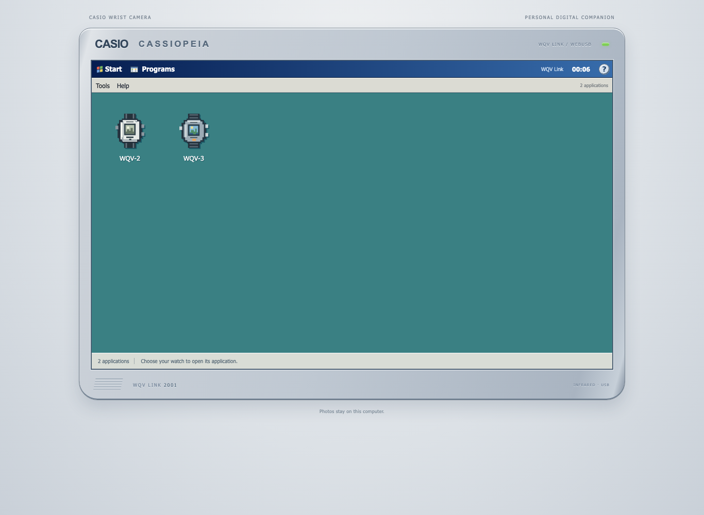

# WQV-online

Read photos from a Casio WQV-2 or WQV-3 wrist camera in your browser, and send
photos back to a WQV-3. Connect a USB infrared adapter through WebUSB or the
KS-959 local helper. The interface takes its look from the Casio CASSIOPEIA
handhelds and Pocket PC 2000.

**[Open the app](https://bolknote.github.io/WQV-online/)**

The opening screen has an app for each watch. Click its icon to open it; the
close button returns to Programs and releases the USB adapter. Each watch has
its own local album. English, Russian and Japanese settings apply to both apps.

The two manual files beside the watch apps open in a Pocket Word-style reader.
They follow the selected display language. The guides use reflowable HTML with
the original illustrations; the Japanese editions have text recognized from
scanned PDFs. The reader has a contents list and a text-size setting.
Original PDF links are available in its File menu. Sources and file hashes are
listed in [the manual catalog](dist/manuals/manifest.json).



## What you need

The tested watches are **Casio WQV-2, module 2220**, and **WQV-3, module 2411**,
on macOS. WQV-3 was tested with Opera; WQV-2 PC downloads were checked with the
native client on both adapters below.

| Adapter | USB ID | Connection |
| --- | --- | --- |
| SigmaTel STIr4200, often called “IrDA/USB Bridge” | `066f:4200` | Direct WebUSB |
| KingSun KS-959, called “USB to IRDA” | `07d0:4959` | Local Python helper |

Neither adapter needs a Windows virtual machine or a kernel driver. The page
uses the USB ID to choose its driver and displays the name supplied by the device.

USB access needs a desktop browser with WebUSB, such as Chrome, Edge or Opera.
Safari and Firefox cannot connect to the adapter. The app starts in English.
Choose **Tools → Options…** to switch to Russian or Japanese. It remembers your
choice in this browser, and switching languages keeps your current photo and connection.

Other infrared adapters need their own USB transport code. **ARK3116T does not
work yet.** WQV-10 and other operating systems have not been tested.

### KingSun KS-959 setup

Download [kingsun_bridge.py](dist/kingsun_bridge.py) and run it in a terminal:

```sh
python3 ~/Downloads/kingsun_bridge.py
```

Leave that terminal open, then click **Connect USB…** in the app and choose
**USB to IRDA**. The page shows the helper instructions when you select a KS-959.
The helper needs Python 3 and libusb (`brew install libusb` on macOS); it uses no
Python packages. Press Ctrl+C when you are done.

The helper is needed because KS-959's speed command addresses interface 1,
while its USB descriptor lists only interface 0. WebUSB rejects that command.
The helper forwards the adapter's USB control transfers on `127.0.0.1:8767`.
Discovery, image transfers and the rest of the watch protocol still run in the
browser. SigmaTel does not use the helper. See [the transport notes](docs/kingsun-ks959.md).

## WQV-2

Open **WQV-2** from Programs, then click **Connect USB…**. Choose **PC** or
**OTHERS** to match the watch. Both modes use the same WQV-2 album.

### PC: current photo or all photos

1. Click **Current photo** or **All photos** and wait for **USB ready**.
2. Click **Start reading**, then select **IR → PC** on WQV-2 and press the
   front **F** button. Keep the infrared windows about 5–10 cm apart.
3. Wait for the transfer to finish. The photos stay in this browser.

**Find watch** opens and closes a connection without downloading photos. The
Connection tab also shows the time returned in the watch's greeting.

The **Clock** tab has **Read watch time** and date/time setting. Choose the
date, hours and minutes, or click **Use computer time**, then **Set**. Wait
for USB preparation and click **Set on watch** before activating IR → PC on
the watch. WQV-2 keeps its seconds unchanged. Reading time uses a separate
connection and does not change the watch.

The clock request and its completion were checked against Casio's original
Palm program, with browser tests for both adapters. A physical WQV-2 check
of clock setting is still pending.

### OTHERS: receive one photo

1. Choose **OTHERS**, click **Receive photo…**, and wait for **USB ready**.
2. From COM on the watch, select **OTHERS** and press **F**. With **SEND**
   selected, press **F** again to open the photos. Choose one with the side buttons.
3. Click **Start receiving** in the app, then press **F** on the watch to send
   the selected photo.

This receiver uses WQV-2's older SUM16 protocol. It has protocol and browser
tests; a hardware check of OTHERS with WQV-2 is still pending. PC downloads of
one photo and all five stored photos have worked with both adapters, producing
identical image files.

WQV-2 transfers use **115200 bit/s**, including OTHERS. The SigmaTel driver
selects a 28-sample receive threshold for this watch; WQV-3 keeps its own
settings. The KS-959 driver synchronizes its receive counter from valid watch
greetings. See the [WQV-2 protocol notes](docs/wqv12-pc-investigation.md).

Photos are 120 × 120 with 16 shades of gray. Save a PNG for viewing or the
original 7229-byte BIN record for a backup. **Open backup…** imports these BIN
records; **Collection ZIP…** saves the album with both formats and metadata.
Local deletion leaves the copy on the watch alone. Photo uploads, remote
photo browsing and editing are not yet implemented for WQV-2. See the
[feature comparison](docs/wqv2-features.md) for the remaining original functions
and the recovered clock packets.

## WQV-3


Choose **PC** or **OTHERS** on the toolbar to match the watch menu. PC has photo,
clock and calendar controls. OTHERS has Photos and Connection, for sending one
photo at a time. Both modes use the same local album. The page remembers the
mode you last used.

### PC

1. Plug in the adapter and open **WQV-3** from [Programs](https://bolknote.github.io/WQV-online/).
   For KS-959, start its helper first.
2. Click **Connect USB…** and choose the adapter.
3. On the watch, select **IR → PC**, then **F / REMOTE**. Face its infrared
   window toward the adapter, about 5–10 cm apart.
4. Download the current photo or the whole collection. You can also import
   an image from your computer and send it to the watch.

If the watch leaves transfer mode, enter IR → PC again. Another application
using the adapter must release it before the browser can connect.

### OTHERS

Connect USB before starting transfer on the watch.

To get a photo from the watch:

1. Choose **OTHERS**, then **Receive photo…**. Wait for **USB ready**.
2. On the watch, choose **IR → OTHERS → SEND**. Press the front button once
   to open the photos, then choose one with the side buttons.
3. Click **Start receiving** on the page, then press the front button again
   to send the selected photo.

To send a photo to the watch, select or import it in the album and click
**To watch →**. Wait for USB to be ready, choose **IR → OTHERS → RECEIVE** on
the watch, click **Start sending**, then press the watch's front button.

Each transfer closes its connection. Start another transfer for the next photo.
The sender uses the watch's SCEP packet limit (2048 bytes on the tested WQV-3)
and retries lost IrLAP frames without starting another upload. Clock, calendar
and remote photo-browsing commands are available in PC mode.

Discovery starts at 9600 bit/s. Once the watch replies, the app negotiates the
fastest shared SIR speed, up to **115200 bit/s**. It negotiates again when the
watch takes over to send photos, and returns to 9600 after disconnecting.
The Connection tab and transfer log show the current speed. Photo downloads at
115200 have been checked with the WQV-3, SigmaTel and KS-959 adapters.
KS-959 PC downloads were checked with the native client; an OTHERS download
was also checked through the browser and helper. Other KS-959 operations use
the shared protocol code but have not all had hardware checks.

## Photos and settings

- Download individual photos or the whole collection. The arrow buttons browse
  photos on the watch; clicking a thumbnail opens the local copy.
- Import images, crop or fit them, rotate them, and prepare a 176 × 144 JPEG
  for the watch.
- Save JPEGs, keep the original UPF or WQV files, or export the collection as a ZIP.
- Read and edit the holiday calendar for 2000–2039, with JSON backups.
- Set the date and time, or sync with the computer at the start of a minute.

Photo downloads, uploads and calendar reading have been checked on a real WQV-3.
Clock setting and calendar writing are implemented and have packet tests, but
have not yet been checked on the watch.

Some JPEGs returned by the watch lose their restart interval marker. The app
repairs these for viewing and export without recompressing the image, while
keeping the original file.

The SigmaTel receiver can recover a few known framing faults by checking CRC
again after correcting an escape sequence or removing one stray edge byte.
Ambiguous frames and frames that still fail CRC are dropped. The Connection
tab counts recovered frames separately from rejected CRC errors.

The receiver also uses PAD-5's empty-read rule when an end marker is damaged
or missing: one empty USB read on chip revisions up to 6, or two in a row on
revision 7 above 9600 bit/s. It checks the full frame first, then tries removing
the last byte. A timeout or a cancelled USB read never completes a frame.
This path has software tests; checking it with the watch is still pending.

If the transmit FIFO stalls, the app tries the PAD-5 recovery sequence and
ends the current transfer. Click **Connect USB…** again and restart **IR → PC**
on the watch before retrying. Completed photos stay in the collection.

Photos and calendar backups stay in this browser. There is no account, upload
server or analytics. Keep a ZIP export if you want a copy outside browser
storage. The hosted app and a localhost copy have separate collections.

In the WQV-3 album, each received or imported file gets its own entry, including
identical copies. Downloading a photo again adds another copy. Captions entered
on the watch appear below the thumbnails and in the preview, with the original
transfer filename underneath. ZIP exports keep every copy and its metadata.

Deleting a local photo only removes that browser copy. Deleting a photo from
the watch still takes the watch's buttons; the app's Help menu has the steps.

## IR research

There is a separate [research page](https://bolknote.github.io/WQV-online/research.html)
with four modes. **Listen** records what SigmaTel receives at a fixed 9600,
38400 or 115200 bit/s. Choose WATCH SEND, OTHERS SEND, SWAN SEND or SWAN RECEIVE,
prepare USB, then start recording before activating that mode on the watch. It sends no discovery,
commands or acknowledgements. Every recording and speed change is manual.

**Discovery** tests whether the watch is waiting for another device to speak.
It sends complete XID searches at 9600 bit/s, advertises itself as WEB-WQV,
and answers searches from the watch. It records any request to connect and
stops there. It sends no application commands and does not accept a connection.

**Serial bytes** tests the WonderWave/WonderWitch lead at 9600 bit/s, 8N1.
Start recording, activate the chosen watch mode, then send `15` (XMODEM NAK)
or `0D` (Enter) with a separate button. The default is one byte per capture,
with no automatic repeats. SWAN RECEIVE is available with its own instructions.
There is also a listen-only control and an optional automatic setting for SEND
modes. No IrLAP framing or XMODEM acknowledgements are added;
raw bytes and possible local echo are kept in the ZIP. These are protocol
hypotheses, not identified Casio commands.

**Commands** keeps the existing step-by-step command probes. Prepare USB first,
restart IR → PC on the watch, then send the selected command. Moving to the
next step is manual. Each attempt keeps its original USB bytes and can be
exported as a ZIP, including failed or interrupted attempts. All four modes use
the same local research journal; previous recordings remain available.

Listen and Discovery keep unknown bytes and failed CRC frames in the original
stream. Their frame decoders use strict IrDA CRC checks without recovery.
The selected mode and speed are test settings, not detected capabilities.
The first passive captures and a WATCH SEND discovery run returned no USB
bytes. Reception in the research modes is still unverified. The effects of
the unknown command codes are not established. See the
[research notes](docs/command-research.md) for instructions and the log format.
There are also [WonderWave notes](docs/wonderwave-research.md) with recovered
WonderWitch serial-transfer sources and what they might tell us about SWAN mode.

The [SWAN packet page](https://bolknote.github.io/WQV-online/swan.html) tests complete candidate packets recovered
from Digimon programs on WonderSwan and PocketStation. Start with the adapter
echo control, then run each watch test separately. Start recording before
activating SWAN RECEIVE and use **Send packet once** when the watch is ready.
There are no automatic replies or repeats. Its separate local journal and ZIPs
keep all USB bytes, planned and completed writes, and possible echo matches.
These packets have not been confirmed as WQV-3 commands. See the
[packet test instructions](docs/swan-packets.md).

For a passive speed comparison, open `swan-listen.html` locally. It has separate
background, SWAN SEND and SWAN RECEIVE steps at 9600 and 38400 bit/s, with no
outgoing packets. Each recording saves its confirmed setup, watch-button marker
and raw USB data. The watch's SWAN speed is still unknown. See the
[listening instructions](docs/swan-listening.md).

The separate OTHERS test page is `irtranp.html`. It keeps the manual research
plans and raw USB recordings. Normal one-photo transfers are now part of the
main app. Sending and receiving have worked on a WQV-3 at 9600 and 115200 bit/s,
including uploads with 2048-byte SCEP packets. Four deliberate link faults
also recovered: a bad CRC, two bad CRCs in a row, a truncated frame and a lost
acknowledgement. In each case the watch displayed the uploaded photo.

The main app sends one photo per connection. Although the watch advertises
multiple PUT operations, our attempts to send two photos in one connection
failed. Metadata the watch discards is kept in the original local UPF.
See the [IrTran-P notes](docs/irtranp-research.md) and
[link recovery details](docs/irtranp-link-recovery.md) for the captures and limits
of those tests. The integrated interface is checked by replaying those recorded
exchanges and has also been used with the same watch and adapter.

## Run locally

The app is plain HTML, CSS and JavaScript. There are no packages to install and
no build step.

```sh
git clone https://github.com/bolknote/WQV-online.git
cd WQV-online
python3 serve.py
```

Open <http://127.0.0.1:8765/> in a browser with WebUSB. Python only serves the
files in `dist/`; all USB communication happens in the browser. Use HTTPS or
localhost, rather than opening `index.html` as a file.

Run the tests with Node.js 24 or later:

```sh
npm test
```

The optional browser checks need Playwright installed separately and the local
server running on its default port:

```sh
node tests/browser/applications.cjs
node tests/browser/others.cjs
```

The first checks Programs, both albums, backup import and export, language
settings, cancellation and WQV-2 exchanges with simulated SigmaTel and KS-959
devices. The second replays captured WQV-3 OTHERS exchanges. Both use isolated
browsers and never open a real adapter. Screenshots go to a temporary folder.
Set `WQV_APP_URL` to use a different local server address.

There is also an independent JPEG pixel check, using Python and Pillow:

```sh
python3 -m venv .venv
.venv/bin/python -m pip install Pillow
.venv/bin/python tests/verify-jpeg-pixels.py
```

GitHub Actions runs the JavaScript tests on pushes and pull requests. A passing
push to `main` publishes `dist/` to GitHub Pages, so the site's root opens
Programs directly.

## Credits and license

By Evgeny Stepanischev. Released under the [MIT license](LICENSE).

The watch protocol work builds on Roger Braunstein's
[WQV Blink](https://github.com/partlyhuman/wqv-blink), also MIT licensed. Its
copyright and license are preserved in [third-party-notices.txt](third-party-notices.txt).
The Linux [STIr4200 driver](https://github.com/torvalds/linux/blob/v4.16/drivers/staging/irda/drivers/stir4200.c)
was a reference for the adapter's registers and USB framing. Additional watch
commands were worked out from Casio's original PC software.
Frame and FIFO recovery behavior was also checked against Casio's original
PAD-5 driver, `stirusb.sys` 1.23.
